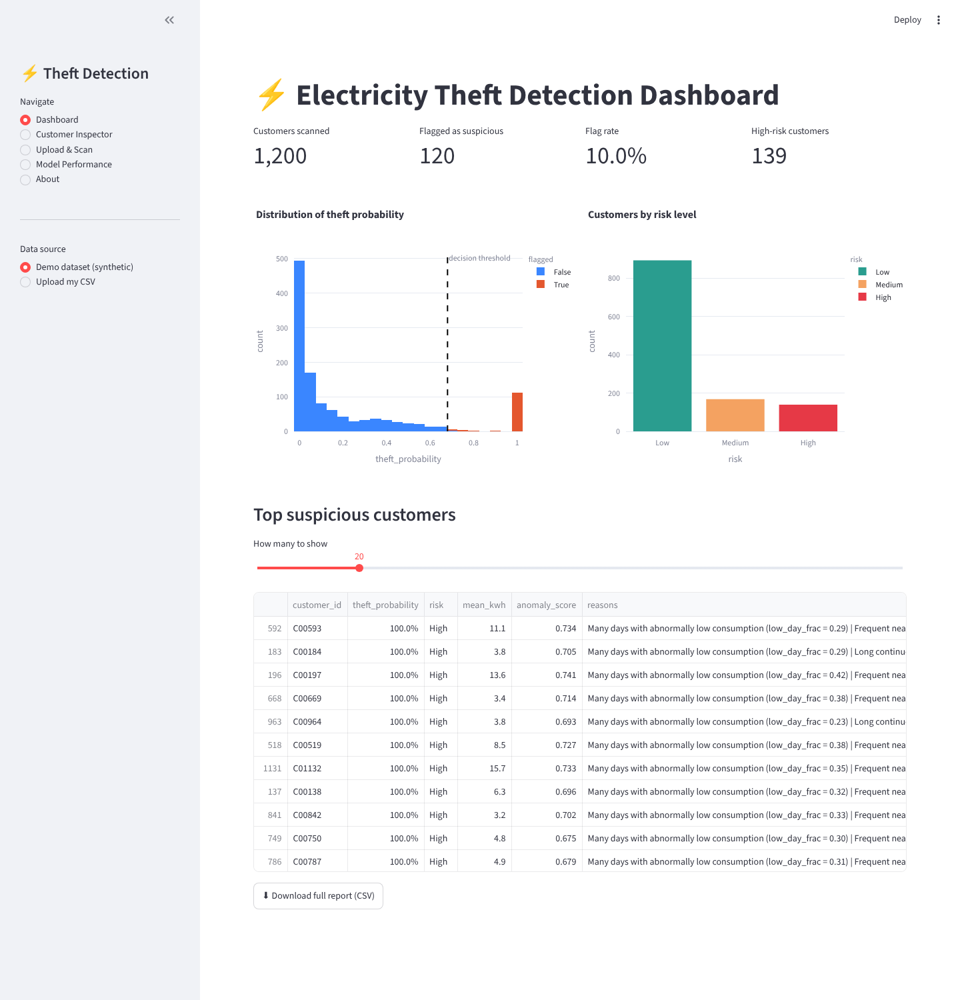
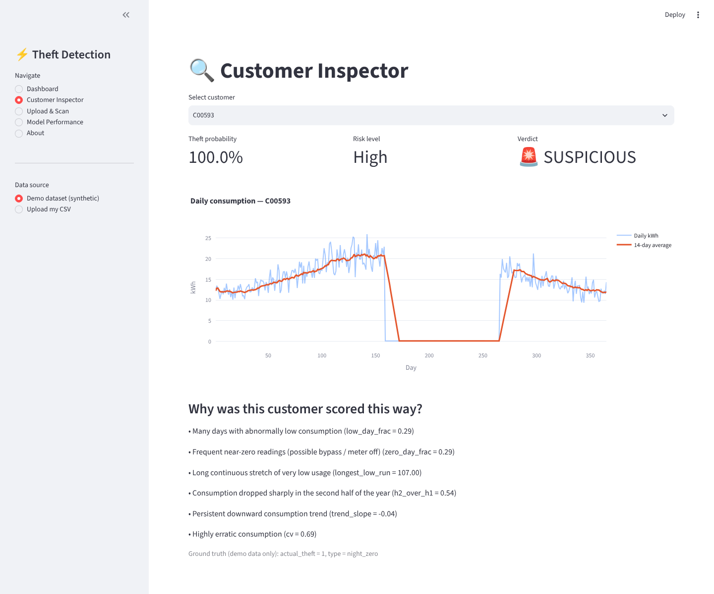
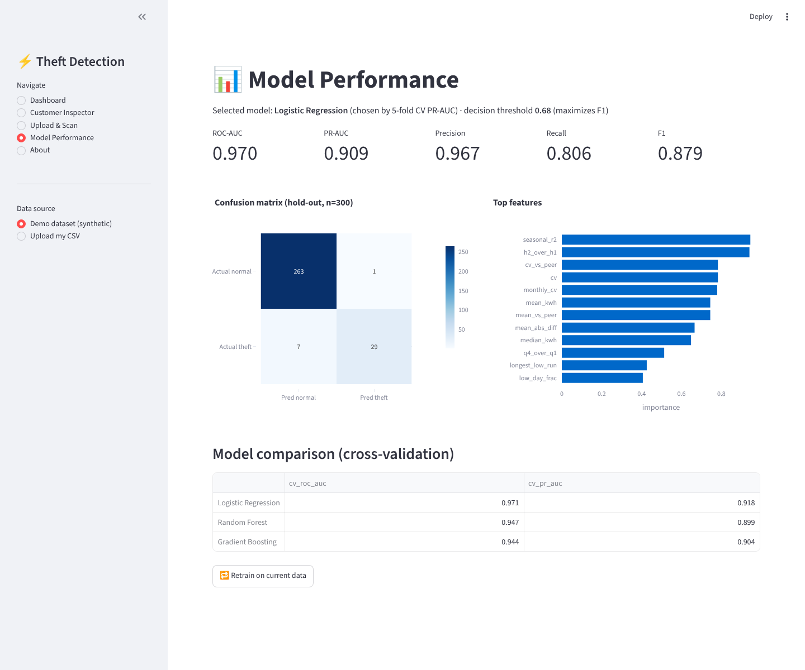

# ⚡ Electricity Theft Detection System

An end-to-end machine-learning system that flags suspicious smart-meter consumption
(meter tampering, line bypass, under-reporting) — with a Streamlit dashboard and a Python backend.

> **TEAM-8 · Euphoria GenX (Techno Exponent) · Dept. of AI & ML · Batch ML77**



## Features
- **Dashboard** – customers scanned, flagged, risk bands, probability histogram, top suspects, CSV report export
- **Customer Inspector** – 365-day consumption chart + plain-English reasons for every score
- **Upload & Scan** – paste 365 daily readings (or generate a sample theft pattern) and score instantly
- **Model Performance** – metrics, confusion matrix, feature importance, one-click retrain
- **Hybrid design** – supervised classifier (known theft patterns) + Isolation Forest (novel anomalies)

| Customer Inspector | Model Performance |
|---|---|
|  |  |

## Quick start
```bash
git clone https://github.com/Shrikaran202005/Electricity-Theft-Detection-Using-Machine-Learning.git
cd Electricity-Theft-Detection-Using-Machine-Learning
pip install -r requirements.txt
streamlit run app.py        # first launch auto-generates data and trains the model
```

Optional manual steps:
```bash
python generate_data.py     # synthetic dataset  -> data/smart_meter_data.csv
python model.py             # app model          -> models/theft_model.joblib
python report_pipeline.py   # report experiment  -> figures/*.png + figures/report_metrics.json
```

## Project structure
| Path | Purpose |
|---|---|
| `app.py` | Streamlit front end (5 pages) |
| `model.py` | Train / evaluate / save / score + rule-based explanations |
| `features.py` | 20 theft-sensitive features per customer (level, volatility, trend, seasonality, low-usage runs, peer ratios) |
| `generate_data.py` | Synthetic smart-meter data with 5 theft attack patterns |
| `report_pipeline.py` | Report experiment: RF + XGBoost (SMOTE), Isolation Forest, One-Class SVM; produces report figures |
| `figures/` | Report figures 4.1–5.3 and `report_metrics.json` |
| `screenshots/` | Application screenshots |

## Results (report experiment — 5,000 customers × 180 days, 8% theft, 1,000-customer hold-out)

| Model | Accuracy | Precision | Recall | F1 | AUC-ROC |
|---|---|---|---|---|---|
| Random Forest (+SMOTE) | 0.978 | 0.863 | 0.863 | 0.863 | 0.967 |
| XGBoost (+SMOTE) | 0.969 | 0.775 | 0.863 | 0.817 | 0.978 |

| Anomaly model (contamination 0.08) | Precision | Recall | F1 |
|---|---|---|---|
| Isolation Forest | 0.861 | 0.850 | 0.855 |
| One-Class SVM | 0.818 | 0.788 | 0.803 |

Numbers come from `report_pipeline.py` (seed 42) on **synthetic** data — see the limitations below.

## Tech stack
Python 3 · Streamlit · pandas · NumPy · scikit-learn · XGBoost · imbalanced-learn (SMOTE) · Plotly · Matplotlib · Seaborn · joblib

## Dataset
Synthetic smart-meter data produced by `generate_data.py`: honest customers follow seasonal + weekly load
patterns; thieves are injected with five patterns from the electricity-theft literature
(constant scale-down, random scaling, gradual drop, intermittent zeros, night-zero block).
To use real data (e.g. the SGCC smart-meter dataset), upload a CSV from the sidebar with
`customer_id`, `d001`…`d365` and optionally `is_theft` to retrain.

## Limitations
- Results on synthetic data are optimistic; real utility data is noisier and theft is harder to separate.
- Constant under-reporting (`scale_down`) can look like a genuinely low-usage household and is the hardest case.
- Daily granularity only; sub-hourly readings would enable richer features.

## License
MIT — see [LICENSE](LICENSE).
